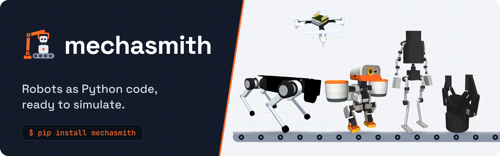
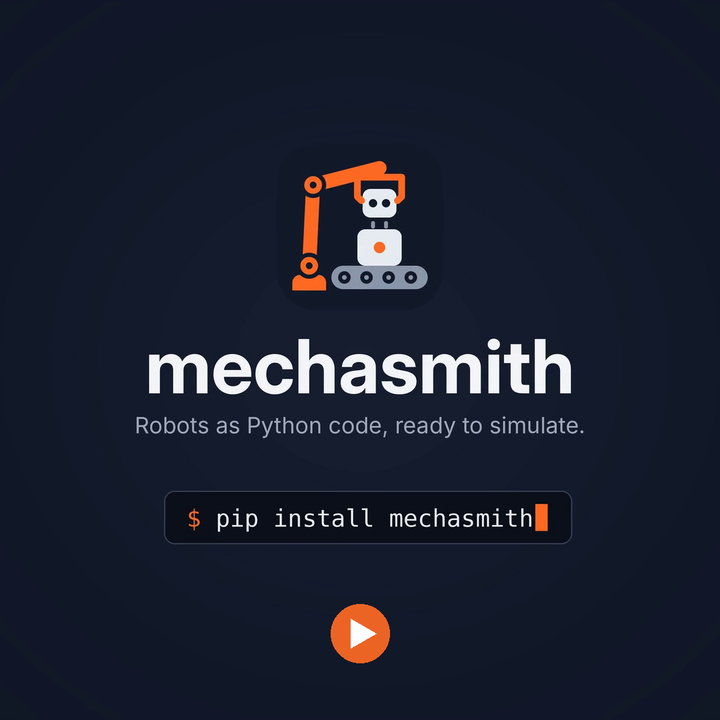
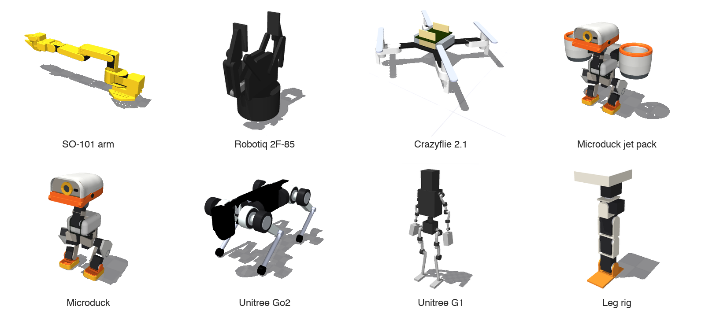
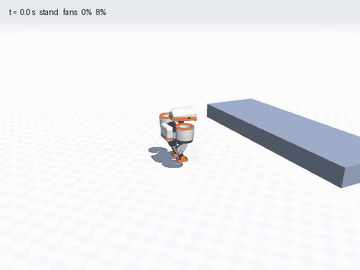

<h1 align="center">
  
</h1>

<p align="center">
  <a href="https://pypi.org/project/mechasmith/"></a>
  <a href="https://github.com/w601sxs/mechasmith/actions/workflows/ci.yml"></a>
  
  <a href="https://github.com/w601sxs/mechasmith/blob/main/LICENSE"></a>
</p>

**Robots as Python code, ready to simulate.** You write a robot as one Python file: parts, the
servos or motors between them, and which part connects to which. `mechasmith build` turns it into a
MuJoCo model (MJCF), a URDF, meshes, renders, a browser viewer and a JSON report of checks:
collisions, joint ranges, whether it stands, hovers or can hold a payload.

It is built to be driven by coding agents. Every command prints JSON, every design parameter has a
declared range, and the library refuses to build a robot with a floating part. So an agent can
change a number, rebuild and read what happened, without a human checking the CAD.

<p align="center">
  <a href="https://github.com/w601sxs/mechasmith/blob/main/docs/media/reel.mp4"></a>
  <br><sub>37 s reel: the examples together, then a Go2 designed and assembled from code. Made with <code>scripts/film_*.py</code>.</sub>
</p>



## Install

```bash
pip install mechasmith          # Python 3.12+
```

or, from a clone, `uv sync` and prefix the commands below with `uv run`.

## Try it

```bash
mechasmith examples             # the bundled designs
mechasmith build so101          # writes build/so101/ and prints the report
open build/so101/viewer.html    # drag a slider per joint
mechasmith copy so101 mybot.py  # start your own from an example
mechasmith describe mybot.py    # its parameters and their ranges
mechasmith build mybot.py --set lift_z=165 --set link_width=28
```

A build takes seconds and writes:

| File | What it is |
|---|---|
| `scene.xml`, `robot.xml` | MuJoCo model, with a floor scene around it |
| `robot.urdf`, `meshes/` | the same robot for Isaac Sim / Isaac Lab, ROS, PyBullet, Drake |
| `robot_mjx.xml` | with `--sim mjx`: a light model for GPU training with MJX |
| `views.png`, `pose_*.png` | renders of the home pose and each named pose |
| `viewer.html` | a self-contained 3D viewer with a slider per joint |
| `report.json` | mass, collisions at home, usable range of every joint, and a stand, hover or arm test |

## The idea: connect parts, never place them

In most code-CAD you position every part with coordinates, and a wrong number gives you a head
floating 7 mm above its neck that nobody notices until the simulation does something odd. In
mechasmith you can't position a part. You connect it to one that is already in the robot, and
mechasmith works out where it goes:

```python
from mechasmith import LEFT, UP, XL330, Assembly, Component, box, design, param, servo, u_bracket

@design(params=dict(neck_z=param(23.4, (15, 40), "neck axis height, mm")))
def build(p):
    trunk = Component.world("trunk", box((-50, -30, -10), (30, 30, 30)))
    trunk.connector("neck_seat", at=(20, 0, 30), normal=UP)        # checked: must be on the surface

    asm = Assembly("bot", root=trunk)
    mount = u_bracket(XL330, "neck_mount", reach=p.neck_z - 30 - 2.5)
    asm.fasten(trunk.c("neck_seat"), mount.c("base"), spin=(mount.AXIS, LEFT))  # face to face
    neck = servo("neck_pitch", XL330)
    asm.fasten(mount.c("horn"), neck.horn.c("face"))
    asm.joint("neck_pitch", neck, range=(-1.57, 1.05))             # the servo is the joint
    head = Component.world("head", box((5, -20, 40), (45, 20, 75)))
    asm.attach(neck.case, head)                                    # must touch, checked now
    return asm.robot()                                             # links come from the connections
```

- **`fasten(a, b)`** puts connector `b` flat against connector `a`. Servos, brackets, horn plates
  and spacers come with connectors, so most parts are placed this way.
- **`attach(base, part)`** is for shapes drawn in place (shells, covers). If they don't touch, the
  build stops on that line: `AttachmentError: head does not touch neck_pitch_case: the gap is 7.61 mm`.
- **`joint(name, servo, range)`** makes a servo a joint. Bodies, joint axes and anchors in the
  MJCF are all derived from the connections; none are written by hand.
- **`asm.link(...)`** draws a whole printed link around a servo: cut clear of it over the joint's
  range, with a pocket for the next servo. **`robot.mirror("left_", "right_")`** makes the other side.

There is more for other kinds of robot: hinges and closed loops (grippers, four-bars), motors from
a datasheet, limbs from a joint table, rotors and IMUs for things that fly, and moulded covers. See
the [API reference](docs/api.md).

## Examples

Each one is a real robot rebuilt from public data and compared with its reference model. The
designs ship with the package (`mechasmith build <name>`) and live in [designs/](designs/).

| Design | What it shows | Result against the reference |
|---|---|---|
| `so101` | 6-servo arm, printed links | all 6 axes within 0.2 mm; 600 g vs 632 g; holds 200 g at full reach |
| `robotiq_2f85` | closed-loop five-bar gripper | all 8 axes on the reference's; 1056 g vs 1053 g |
| `crazyflie2` | quadrotor, rotors and IMU | 27.1 g vs 27.0 g; hovers, thrust-to-weight 2.26 |
| `microduck` | 14-servo biped (Pollen's Microduck) | all 14 axes within 0.8 mm; 692 g vs 737 g |
| `microduck_jetpack` | the duck with two tilting ducted fans | 1248 g; hovers with thrust vectoring |
| `go2` | quadruped on motors (Unitree Go2) | all 12 axes on the reference's; 14.85 kg vs 15.21 kg; stands |
| `g1` | 29-DOF humanoid (Unitree G1) | all 29 axes on the reference's; stands like the reference |
| `duck_leg` | a single 5-servo leg | full joint ranges with no collisions |

Microduck falls in the servo-only stand test, as Pollen's own model does: at the real mass its
head tips it over without a balance controller.

Beyond the designs, [examples/](examples/) has the training side:

- [rl_microduck](examples/rl_microduck/): teach the Microduck to walk with MJX and Brax PPO. It
  tracks 0.3 m/s commands with an even gait after 300 M steps (about 25 minutes on one GPU).
- [rl_jetpack](examples/rl_jetpack/): one policy that walks, hops, flies and lands the jet-pack duck.
- [microduck_jetpack](examples/microduck_jetpack/): a hand-written flight controller and Blender renders.



## Using it with a coding agent

Point the agent at [AGENTS.md](AGENTS.md). It covers the build-and-read-the-report loop, the
rules that keep designs correct, which example to start from for each kind of robot, and how to
check a rebuild against a reference model.

## Tools for checking against a reference

From a clone, [scripts/](scripts/) compares a design with an existing MJCF:

```bash
uv run python scripts/compare_joints.py reference.xml build/so101 --site gripper=gripper  # axis by axis
uv run python scripts/compare_looks.py reference.xml build/go2/robot.xml --png looks.png   # outline overlap
uv run --with yourdfpy python scripts/check_urdf.py build/so101                          # URDF agrees with MJCF
uv run python scripts/sweep_param.py designs/duck_leg.py foot_reach left_ankle 12,14,16    # one knob, many builds
```

Two more film the examples (they need ffmpeg, and an OpenGL context: on a headless machine run them
under Xvfb with `MUJOCO_GL=glfw`):

```bash
uv run python scripts/film_title.py title.mp4                     # opening card: logo, name, pip install line
uv run python scripts/film_lineup.py build lineup.mp4             # every example, posed together, orbiting camera
uv run python scripts/film_go2_assembly.py build go2_assembly.mp4 # Go2 torso designed from code, assembled, turntable
```

## Conventions

Millimetres; x forward, y left, z up, in one world frame at the home pose. Servo frame: +X is the
output axis (horn side). Masses come from the CAD solids with a 3D-printing infill model.
More in the [API reference](docs/api.md#conventions).

## Status

Alpha (0.1). The API has settled around connections, but names may still change. How it got here,
robot by robot: [docs/history.md](docs/history.md).

## License

MIT
