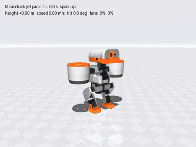
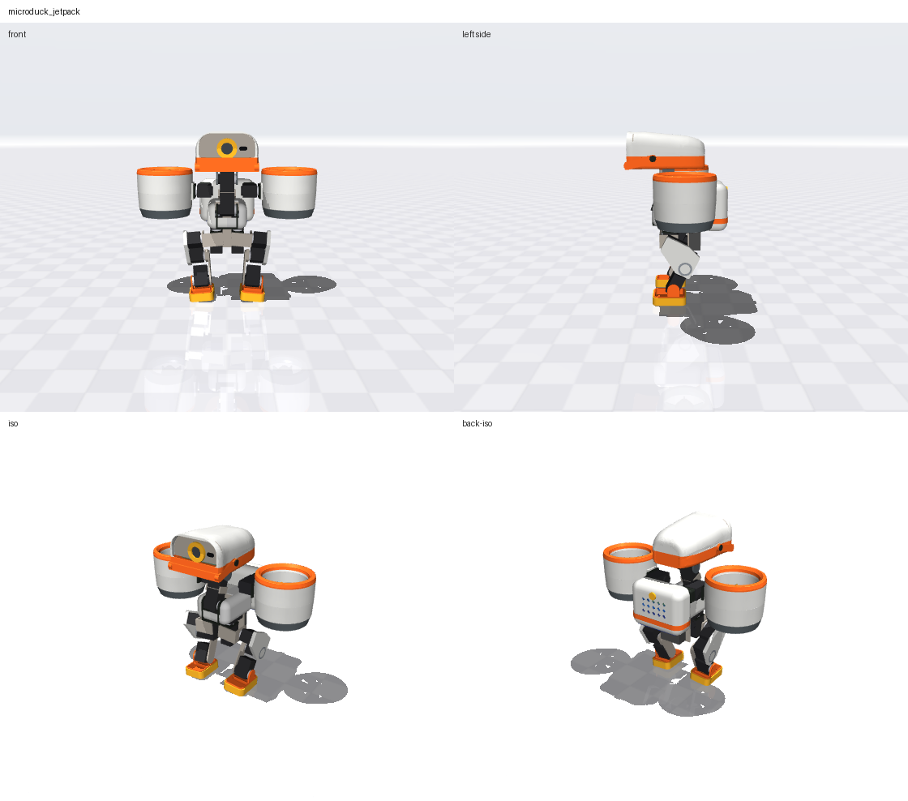

# I gave the Microduck a jet pack



`designs/microduck_jetpack.py` is the mechasmith Microduck (`designs/microduck.py`, built
unchanged) with a backpack and two tilting 70 mm ducted fans. It flies as a **tilt-birotor**,
like a V-Coptr:

| axis | how |
|---|---|
| height | both fans' throttle |
| roll | differential thrust (fans 103 mm either side) |
| pitch | both nacelles tilt the same way (the fans sit ~30 mm above the centre of mass) |
| yaw | the nacelles tilt opposite ways; the fans counter-rotate so their torques cancel |
| forward flight | the body leans nose-down and the thrust leans with it, as on a helicopter |

```bash
uv run mechasmith build designs/microduck_jetpack.py --sim mjx   # build/microduck_jetpack/
uv run python examples/microduck_jetpack/fly.py                 # build/microduck_jetpack/flight.gif
```



## What is in it

- **Backpack**: a thin-walled LW-PLA (foaming PLA) shell bolted to the trunk's back, with vents
  and an orange band. It holds a 4S 1300 mAh LiPo (160 g), two 60 A ESCs (28 g each) and the
  flight controller (12 g; its IMU site `fc_imu` carries gyro, accelerometer, orientation,
  velocity and position sensors).
- **Pylons and tilt servos**: one XL330 on each shoulder, axis along y, as joints
  `jet_left_tilt` / `jet_right_tilt` (+-0.7 rad; positive tilts the thrust forward on both sides).
- **Nacelles**: revolved LW-PLA fairing with an orange bell-mouth lip and a dark exit nozzle;
  inside, the EDF housing with stator vanes and tail cone, the motor can, a 12-blade fan and a
  spinner. Each fan is a rotor (`asm.rotor`): a MuJoCo site actuator on the fan hub giving
  0-12 N along the nacelle axis plus its reaction torque, so the thrust tilts with the nacelle.

## Feasibility (what was assumed)

| item | value | note |
|---|---|---|
| duck | 692 g | `microduck.py` as is, its 100 g battery included |
| pack + fans | 555 g | LiPo 160, ESCs 56, FC 12, pack shell and trim 15, 2 x nacelle 132 (motor 62, fan + spinner 14, housing 28, fairing + yoke 28), pylons and tilt servos 49 |
| **total** | **1248 g** | |
| thrust | 2 x 12 N | 70 mm 12-blade EDF on 4S, ~1.2 kgf static at ~55 A (typical catalogue figure; verify) |
| thrust-to-weight | 1.96 | hover at 51 % throttle |
| flight time | ~1 min | ~60 A in hover from 1300 mAh; a 2200 mAh pack (+80 g) gives ~1.5 min |
| tilt servo | XL330 | thrust passes through the tilt axis, so holding needs almost no torque; ~11 rad/s |

So it is feasible, but marginal, like real EDF jet packs: thrust margin is fine, endurance is
short. Lighter options: power the duck's servos from the LiPo through a BEC and drop its own
battery (`--set duck_battery_g=20`, -80 g), or a 3S pack with 64 mm fans (thrust-to-weight
falls to ~1.4).

Not modelled: fan spool-up lag (EDFs take ~0.1 s, which is why roll and height, the fast axes,
are still fine with throttle but would want care on hardware), gyroscopic torque of the fans,
aerodynamic drag and ground effect. The exhaust plumes and smoke in the GIF are drawn for fun.
The plumes are sized by each fan's thrust, along its axis. The smoke (`smoke.py`) is a small
particle system: puffs leave each nozzle at a rate and speed set by the thrust, slow down, grow
and fade. Puffs that reach the floor or a box top are thrown outward, so near the ground the
jets kick up a ring of dust. They are composited onto each frame as soft blobs, hidden behind
nearer geometry by the depth buffer. MuJoCo has no fluids, so this is a look, not a flow
simulation, and it pushes on nothing.

## What it took in mechasmith

- **Thrust vectoring in the library.** `mjcf.hover_trim` now solves for the rotor thrusts *and*
  the targets of any position servo that carries a rotor (thrust = weight, zero moments) and
  returns the Jacobian of [thrust, roll, pitch, yaw] with respect to them. The build's `hover`
  keyframe, the keyframes of rotorcraft with joints (`home` etc., fans off) and the build's
  closed-loop `hover` check all use it, with the tilt servos in the loop. Fixed-rotor craft get
  exactly what they got before (Crazyflie unchanged).
- **Tilt-servo gain.** With the XL330 model's leg tuning (kp 0.55 N m/rad, Pollen's fit) the
  servo's friction makes a ~0.5 deg deadband, as large as the corrections a hover needs, and
  the nacelles stick-slip (a +-2 deg pitch wobble). The tilt servos use a ~5x higher Position
  P gain (kp 3, kv 0.05); Dynamixel's P gain is a register, but verify the response on hardware.
- **Where the fans go.** `duct_x` puts the fan axes over the centre of mass (x = -23 mm with the
  pack's weight behind the trunk), so the hover trim needs almost no tilt (-0.6 deg); otherwise
  the duck would hover with a steady horizontal push.

Build report: `hovers: true` (from 10 deg tilt it settles to 0.75 deg, 0.5 mm height error),
no collisions at home. The sweep finds one cost of the pack: looking up/back, the head meets it,
so `neck_pitch` is usable to +0.58 rad (of +1.05) and `head_pitch` from +0.03 rad.

## The controller (`fly.py`)

Hand-written, no learning: position PD (+ a little integral, + feed-forward from a
minimum-jerk mission) gives the thrust vector, an SO(3) attitude PD (wn = 8 rad/s, integral on
pitch) gives the moments, and the trim Jacobian's pseudo-inverse turns those into two thrusts
and two tilt targets. Mission: spool up, take off to 0.65 m, hover, 1.6 m forward at up to
0.9 m/s, yaw 180 deg, fly back, land. Worst position error in flight is 0.2 m (during the
accelerations; no drag means the position loop does all the braking).

The duck cannot stand on servo stiffness alone, with or without the pack (that is what the
walking policy in `examples/rl_microduck` learns), so the attitude loop runs from t = 0 and
after touchdown the fans stay at 80 % of hover to hold it upright.

## Next

- RL for flight: `robot_mjx.xml` has the fans, tilt servos and a `hover` key and loads and
  steps in MJX, so the `rl_microduck` setup could learn hover and flight, and use the legs and
  neck to shift the centre of mass (or to stand after landing).
- A folding-leg variant to cut drag and the pitch inertia.
