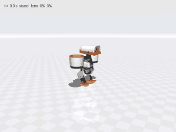
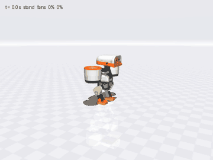
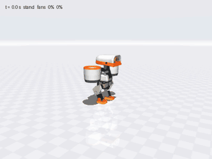
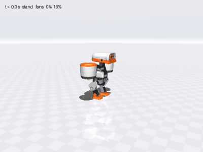

# One policy to walk, hop, fly and land: the jet-pack Microduck

A single RL policy (Brax PPO on MJX) drives all 18 actuators of `designs/microduck_jetpack.py`:
the 14 duck servos, the 2 nacelle-tilt servos and the 2 ducted fans. Unlike the hand-written
flight controller in `examples/microduck_jetpack/fly.py`, nothing tells it which skill to use:
it is given a speed, a turn rate and a height for the trunk above the ground under it, and the
fans cost energy.

- Height = standing height: walk. If the ground ahead rises (a box), standing height means
  getting on top of it, so it has to step, hop (fan-assisted) or fly to follow the command.
- Height above standing: fly, hover; back to standing height: land.

1. Export the training model and copy it here:
   ```bash
   uv run mechasmith build designs/microduck_jetpack.py --sim mjx
   cp build/microduck_jetpack/robot_mjx.xml examples/rl_jetpack/jet_mjx.xml
   ```
2. Smoke test on CPU (a couple of minutes):
   ```bash
   cd examples/rl_jetpack
   PYTHONPATH=. uv run --no-project --python 3.12 --with jax==0.7.2 --with brax==0.14.2 --with mujoco==3.17.0 \
       --with mujoco-mjx==3.17.0 python train.py --smoke
   ```
3. Train on one GPU: `bash run_job.sh 600000000 8192` (same job script as `rl_microduck`).
4. Watch it: `python play.py policy.b64 --box 0.15 --out course.gif` (add `--with pillow`): walk to
   a box and past it, take off, fly forward, hover, land, walk. Add `--record course.npz` to
   render the course in Blender with Mantaflow smoke (`examples/microduck_jetpack/blender/`;
   use `render.py --adaptive --res 800` for a course this long).

## The task (`jet_env.py`)

Episodes are one of: on the ground with command segments switching between walking and flying
(so take-offs and landings happen at the switches); a 0.4 m box across the path with a
walk-forward command, whose height rises per simulated duck each time it gets past (3 cm to
30 cm) and drops when it falls; or an airborne start (fans at hover) told to fly or to land.

Observations: IMU, joint angles and velocities, last action, fan thrusts, command, gait clock,
plus body velocity, height above the ground and the box ahead (near and far edge, top). Those
three need sensors a real duck would add: an optical-flow / state estimate, and downward and
forward range sensors.

Actions: joint targets as offsets from home (rate-limited to the XL330's 10.8 rad/s) and each
fan's thrust as a fraction of 12 N, through a 60 ms spool-up lag (EDFs take ~0.05-0.1 s).
50 Hz was too coarse for flight, so the policy acts every 12 ms.

Rewards: track the speed, turn rate and height; when walking, the gait clock, air time, equal
steps and level hips from `rl_microduck`; when flying, legs and head held still; upright and
smooth everywhere; soft touchdowns; and fan energy (costly when walking, cheap when flying), so
it walks wherever walking works.

## Results (two runs, 600 M steps each, 69 minutes on one H100 each)

Run 1 trained walk / fly / hop / land; run 2 the same plus the moon run (same code as here).
Neither falls in the course replays; neither learned to get over a tall box by itself.



**Run 1** (`5058e47`'s four-number command): on a 5 cm box it walks over with a light fan
assist. On a 15 cm box it walks up and stops at the edge; on the take-off command it climbs to
0.5 m (both fans at 52 %, the hand-written controller's hover throttle), flies 2 m over the box,
hovers, lands on the far side (fans to 0) and walks on: walk to an obstacle, fly over it, land,
with the flight commanded rather than chosen.



**Run 2**: the whole 5 cm course, including the moon run: 0.54 m/s of 0.7 commanded with the fans
at 41 % each, i.e. carrying the commanded 80 % of the weight. It is a skim more than a bound:
both feet are off the ground about half the time but the trunk only rises 12.5-13.7 cm, and it
does much the same when asked for 0.6 m/s at lightness 0 (faster than it was ever asked to walk,
so it uses the fans anyway). On the 15 cm box it stops at the edge, and taking off from there it
catches the box and falls.

What did not work:
- **The obstacle curriculum stalled** at 3-6 cm in both runs (2-5 cm in run 2): the only pull
  past a box is speed tracking, which waiting at the box mostly keeps, and a fall in an
  obstacle episode lowers the box again. So no self-chosen fan-assisted hop yet.
- **The fans idle while walking** (10-30 %): the walking fan cost (2.0 x thrust fraction) is
  small next to the tracking rewards.
- **Moon bounds are low**: nothing rewards height in the air, only air time.

Next run: a bonus for getting past the box and a higher box only after clean passes; a larger
walking fan cost; and for the moon run, reward the trunk's rise in flight (or a commanded stride
period) rather than air time alone.

## Run 4: long jump, flat feet, box fixes (1.5 B steps, 166 minutes on one H100)



Added: a puddle across the path (a foot in the water ends the episode) with the trunk held
within 10 cm of standing height and fan boosts capped at 0.4 s, so the long jump is not a
flight; a penalty on tilted soles; a pass bonus and forward-progress reward for obstacles, a
gentler curriculum drop, 3x the walking fan cost; and a sign fix in the obstacle sensor.

- **Puddles: cleared, but by gliding, not leaping.** It clears every puddle it is given,
  25-80 cm (the curriculum only reached 30 cm, in the last quarter of the run), without a
  splash. The crossing is one 0.9 s airborne stretch covering 0.75-0.8 m, with the fans at about
  40 % (80 % of the weight; 60 % peak) and the trunk only 2 cm above standing height. It pays
  the boost-cap penalty rather than risk the water: a low fan-carried glide, halfway between
  a jump and a flight. The run-up uses ~20 % fan.
- **Boxes: still stops at the edge**, now even at 10 cm in the replay (training reached boxes
  of 6-11 cm, up from 3-6 cm). On the 15 cm course it waits, then flies over on command and
  lands, as run 1 did.
- **Flat feet, mostly**: soles on the ground tilt 2.9 deg (median) walking at 0.2 m/s, 7.5 deg
  running at 0.8 m/s and 6.3 deg moon-running (90th percentiles 9, 15 and 13 deg). Walking still
  idles the fans at 12 % (28 % running).
- The moon run, flight, hover and landing still work; it never fell on the puddle courses.

## Run 6: hop on command (stopped at 1.25 B steps, 142 minutes on one H100)



Added a sixth command, **hop**: a 2 Hz two-footed bound, rewarded only when commanded (the
alternating-gait terms are switched off while hopping and the hop terms otherwise), a penalty on
two-footed landings when not hopping, a binding boost cap (after 0.4 s above 30 % thrust the fans
are held below 29 % unless flying or moon-running) and a 2.2 Hz running cadence. The job was
preempted at 1.25 B of 1.5 B steps; the curricula had been flat since ~0.8 B, so it was not rerun.
Footfalls over 4 s (`build/rl_tools/gait.py`):

| command | touchdowns | of which two-footed | one foot down | both | none | fans |
|---|---|---|---|---|---|---|
| walk 0.2 m/s | 13 | 0 | 86 % | 14 % | 0 % | 7 % |
| run 0.8 m/s | 11 | 0 | 57 % | 0 % | 43 % | 30 % |
| moon run 0.7 m/s | 12 | 0 | 45 % | 0 % | 55 % | 41 % |
| hop 0.25 m/s | 22 | 22 | 5 % | 23 % | 73 % | 47 % |
| hop + moon 0.7 m/s | 24 | 24 | 4 % | 12 % | 84 % | 48 % |

- **Hop is now a skill on command**: every landing is two-footed when hopping and none is
  otherwise; walking and running alternate feet again (run 4 hopped everywhere). Plain hopping
  is fan-assisted, though (47 %, about the moon run's level), since nothing makes it pay for that.
- Walking fans down to 7 % (12 % in run 4). The whole flat course (walk, hop, moon run, take off,
  fly 2 m, hover, land, walk) runs without a fall.
- **Puddles: lost.** With the boost cap binding, the run 4 glide is gone and no leap replaced
  it: at 0.8 m/s its longest airborne stretch is 0.16 s (12 cm), and it steps into every puddle
  from 25 to 80 cm. The puddle curriculum never left its 15 cm start.
- **Boxes: a bug, found.** The episode ends when the trunk is less than 6 cm above "the ground
  under it", and over a box that ground is the box top. So the moment the trunk's centre crosses
  the near edge of a box taller than ~6 cm, with the feet still on the floor, the duck counts as
  fallen (in the replay, at x = 0.6 m on a 10 cm box, standing upright). This is why the box
  curriculum stalled at 6-11 cm in every run, and why it learned to stop at the edge.

Next run: test falls against the ground under the feet, not under the trunk; give the puddle a
leap-shaped reward (distance covered per airborne phase, or a puddle curriculum starting at a
few cm) instead of leaving the run-up to discover it; and a fan cost on hopping.
